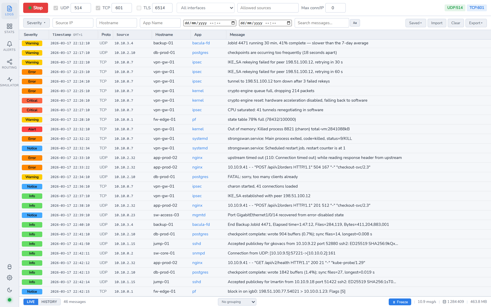
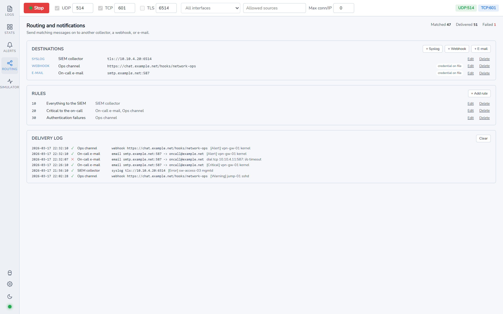
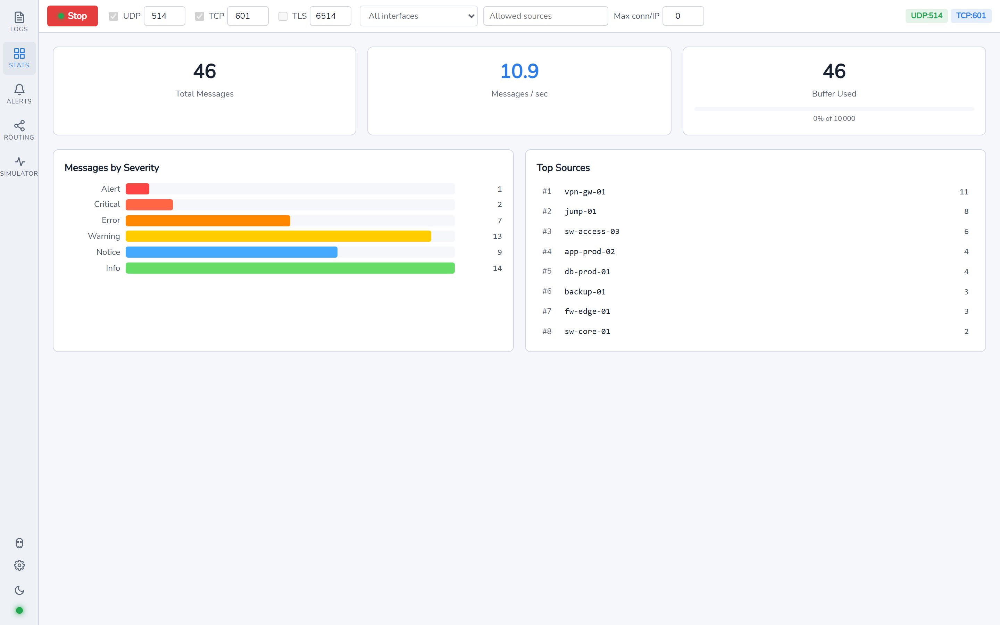
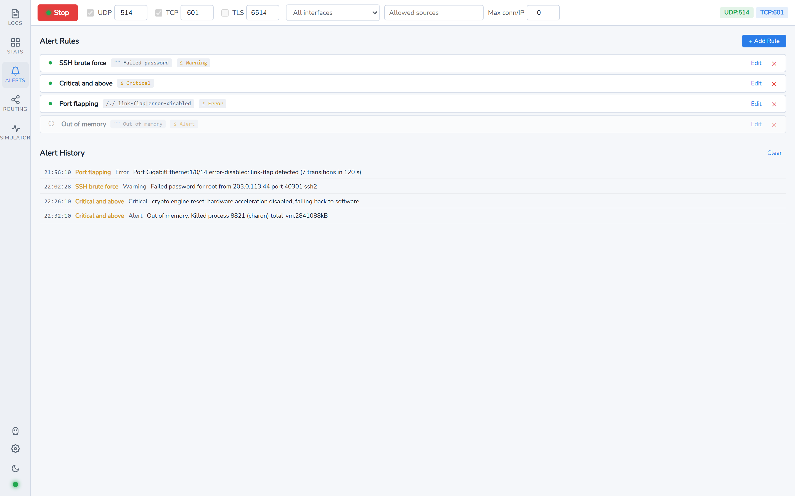
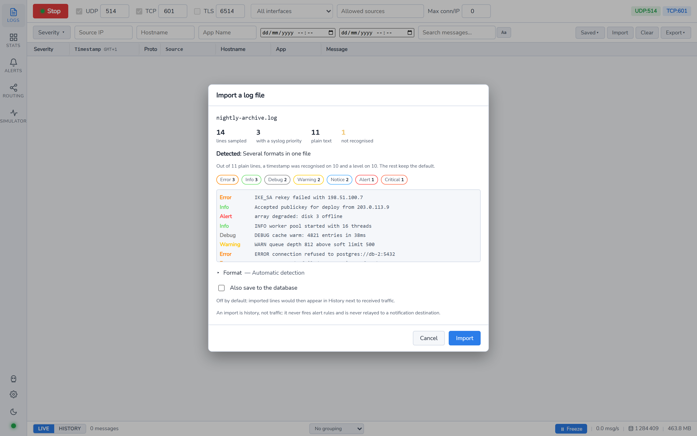
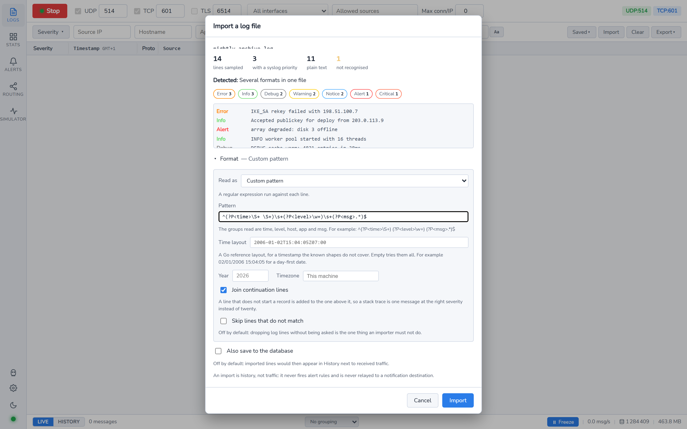
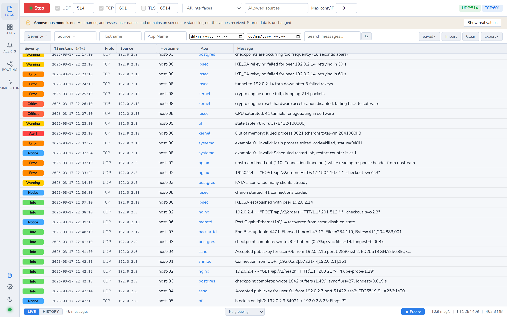
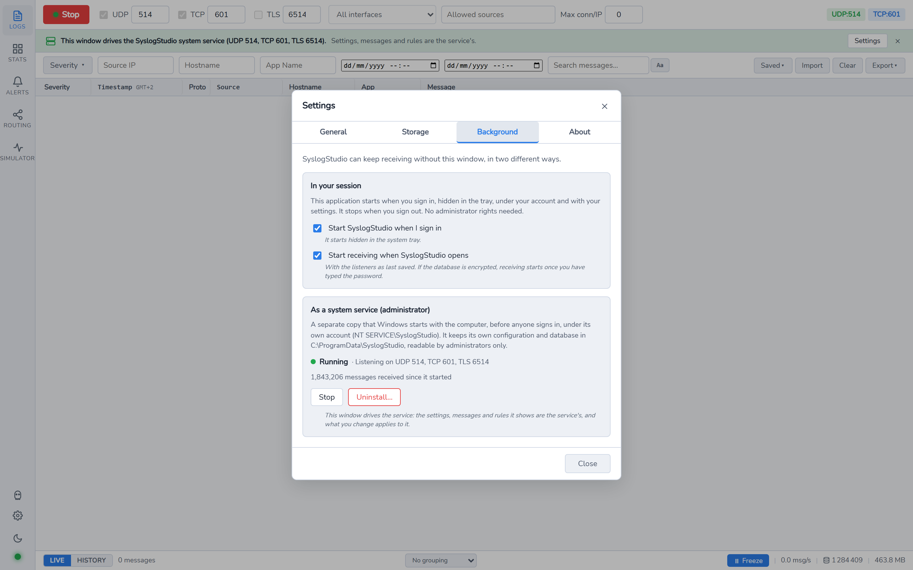
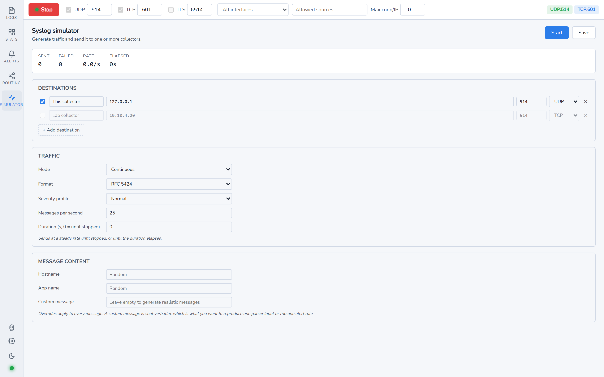

# SyslogStudio

<p align="center">
  
</p>

<p align="center">
  A syslog server, log viewer and alert router in one native binary.<br />
  Built with <a href="https://wails.io/">Wails</a> — Go and Svelte.
</p>

<p align="center">
  <a href="http://geoffrey-lecoq.fr/SyslogStudio/"><b>Website</b></a> ·
  <a href="http://geoffrey-lecoq.fr/SyslogStudio/demo.html"><b>Try it in your browser</b></a> ·
  <a href="http://geoffrey-lecoq.fr/SyslogStudio/download.html"><b>Download</b></a> ·
  <a href="http://geoffrey-lecoq.fr/SyslogStudio/documentation.html"><b>Documentation</b></a>
</p>

<p align="center">
  <a href="https://github.com/Wasabules/SyslogStudio/actions/workflows/ci.yml"></a>
  <a href="https://github.com/Wasabules/SyslogStudio/releases/latest"></a>
  <a href="https://github.com/Wasabules/SyslogStudio/releases"></a>
  <a href="https://github.com/Wasabules/SyslogStudio/blob/main/LICENSE"></a>
  
  
  
</p>

Point your switches, firewalls and servers at it and read what they say. Receive over
UDP, TCP or TLS, search months of history in a local database, raise alerts on the lines
that matter, and relay those lines on to another collector, a webhook or your inbox.
No agent, no account, no service to stand up.

> **Try it without installing anything.** The
> [browser demo](http://geoffrey-lecoq.fr/SyslogStudio/demo.html) is the real application
> running on sample data, with the Go backend replaced by fixtures. Every screenshot below
> comes from that same bundle, so none of them can show an interface the product does not
> actually produce.

---

## Screenshots

### Live log viewer

Messages as they arrive, with severity badges, sortable columns, filtering and group-by.

<picture>
  <source media="(prefers-color-scheme: dark)" srcset="docs/assets/img/live-dark.png" />
  
</picture>

### Routing and notifications

Rules decide which messages are interesting; destinations decide where they go — another
syslog collector, a webhook, or e-mail.

<picture>
  <source media="(prefers-color-scheme: dark)" srcset="docs/assets/img/routing-dark.png" />
  
</picture>

### Statistics

<picture>
  <source media="(prefers-color-scheme: dark)" srcset="docs/assets/img/dashboard-dark.png" />
  
</picture>

### Alerts

<picture>
  <source media="(prefers-color-scheme: dark)" srcset="docs/assets/img/alerts-dark.png" />
  
</picture>

### Importing a log file

A log file already on disk, sorted by severity. What was read and what was guessed are counted
separately, before anything is imported.

<picture>
  <source media="(prefers-color-scheme: dark)" srcset="docs/assets/img/import-dark.png" />
  
</picture>

Detection reads a timestamp at the front of the line and a severity word standing on its own,
which covers most files. When it does not — JSON lines, an access log, a stack trace — the
format can be declared, and the sample is re-read on every change.

<picture>
  <source media="(prefers-color-scheme: dark)" srcset="docs/assets/img/import-format-dark.png" />
  
</picture>

### Anonymous mode

Hostnames, addresses and user names replaced by stable stand-ins, so a screenshot can go
in a ticket without going through a redaction tool first.

<picture>
  <source media="(prefers-color-scheme: dark)" srcset="docs/assets/img/anonymous-dark.png" />
  
</picture>

### Running with no window

In your session, started at sign-in and hidden in the tray — or as a Windows service that
starts with the computer, before anyone signs in, and that the window then drives.

<picture>
  <source media="(prefers-color-scheme: dark)" srcset="docs/assets/img/background-dark.png" />
  
</picture>

### Built-in traffic generator

<picture>
  <source media="(prefers-color-scheme: dark)" srcset="docs/assets/img/simulator-dark.png" />
  
</picture>

---

## Features

### Receiving

- **UDP, TCP and TLS** listeners, any port, bound to one interface or all of them
- **RFC 5424 with an RFC 3164 fallback**, on every transport — the switch that has not been
  updated since 2009 still parses
- **Mutual TLS** where senders must prove who they are
- **Allowed sources** by IP literal or CIDR (hygiene, not authentication — see the note below)
- **Per-IP connection cap** so one host cannot occupy every slot

### Reading

- **Live view** — an in-memory ring buffer of the last 10 000 messages, updating as they arrive
- **History** — server-side paginated queries over the database, as far back as your retention
- **Three search modes** — substring, SQLite FTS5 full-text, and Go regular expressions
- **Filter, sort and group** by severity, facility, host, application, source IP or time range
- **Explicit timezones** — follow the machine, pin to UTC, or name a zone; the column header
  says which one it is showing
- **Right-click a line** to copy it (message, raw line, JSON, or the cell you aimed at), to
  narrow the view to that host, application, severity or the five minutes around it, or to turn
  it into an alert rule. In anonymous mode copying yields what is on screen, and the real value
  is a separate entry — you cannot paste a real address believing it was masked
- **Columns you arrange** — drag an edge to resize, double-click it to fit the widest value,
  drag a heading to move the column, and right-click any heading to add or remove one: facility,
  process id, message id, RFC version and received time are all there, hidden until wanted.
  Widths, order and choice are remembered
- **Keyboard navigation** — arrows, Page Up/Down, Home/End walk the list, Escape closes the
  detail, `/` jumps to the search box. Shift+arrows extend a selection
- **Pick several lines** — click, Ctrl-click, Shift-click, then copy them or export exactly
  those. In anonymous mode you copy what is on screen, not what is behind it
- **Freeze the stream** while you read it — nothing is dropped, and the list says how many
  arrived and catches up when you release it
- **Saved filters** — name the set of criteria you keep retyping and recall it in one click
- **Drop a log file on the window** to import it, with the same preview as the file picker
- **A detail panel you can widen** — drag the edge between the list and the message, double-click
  it to go back to the default
- **Export** as CSV, plain text, NDJSON, syslog (RFC 5424 or RFC 3164, replayable into any
  collector — including this one) or a self-contained HTML report for someone who does not have
  the application. In anonymous mode the export follows the screen by default, and says so
- **Import a log file** already on disk — `.log`, `.txt` or a rotated `.gz`. A captured
  syslog file is parsed exactly as it would be off the wire; a plain application log has its
  timestamp and level read out of the text, and a preview says how much was read and how much
  was inferred before anything is imported. An import never fires alert rules and is never
  relayed onward
- **Describe the file when guessing is not enough** — JSON lines, an access log, logfmt, or a
  regular expression with named groups, plus the year and timezone a file leaves unsaid.
  Continuation lines fold into the record above them, so a stack trace is one message at the
  right severity instead of twenty. Every change re-reads the same sampled lines, and the
  format that worked is remembered for the next import

### Keeping

- **SQLite persistence** with retention by age, count and size, cleaned in the background
- **At-rest encryption** — AES-256-GCM with Argon2id key derivation, the password held in
  memory only
- **Brute-force protection** that survives a restart, so a stolen laptop cannot be
  brute-forced by relaunching the application

### Noticing

- **Alert rules** on a substring or regular expression, a severity floor, a host or an
  application, with a cooldown so one flapping port is not four hundred notifications
- **Desktop notifications** and an alert history

### Forwarding

- **Rule-based routing** of *every* received message, not only the ones that trip an alert —
  which is what makes relaying a whole stream possible
- **Three destination kinds** — syslog (UDP/TCP/TLS, keeping the origin hostname), webhook
  (JSON envelope or your own template), and e-mail (STARTTLS, implicit TLS or none;
  authenticated or anonymous)
- **Mutual TLS** for syslog and e-mail destinations, each with its own trust anchor
- **Write-only credentials bound to their destination** — moving a webhook to another host
  drops the stored token rather than following it there
- **Loop detection** — a destination aimed at this application's own listener is refused, and
  a message already relayed is not relayed again
- **Rate breaker** — a destination flooded with repeating content is cut off, disabled and
  reported, rather than quietly filling a disk

### Running unattended

- **In your session** — start at sign-in, hidden in the tray, and start receiving on launch
  with the saved listeners. No administrator needed
- **As a system service**, on Windows or on Linux with systemd — installed from Settings >
  Background with one administrator prompt; starts at boot under its own account
  (`NT SERVICE\SyslogStudio`, or a `syslogstudio` system user on Linux) with its own
  configuration and database, credentials and private key protected by DPAPI, a firewall
  rule for domain and private networks, and automatic restart after a failure. An encrypted
  database stays encrypted: the service seals what it receives for your window to collect
- **Headless** — `SyslogStudio --headless` runs the engine with no window, for systemd,
  launchd or a terminal

### The rest

- **Built-in traffic generator** to prove the chain works before a device is pointed at it
- **Anonymous mode** masking hosts, addresses, MACs, e-mails and user names with stable
  stand-ins from the documentation ranges (RFC 5737, RFC 3849)
- **TLS/PKI assistant** — generate a CA and server certificates from the interface; both are
  kept across restarts, so clients meet the certificate they were told to trust. A
  certificate given as files is re-read when it is renewed on disk, without a restart
- **Light and dark themes**, persisted
- **Eight languages** — English, French, German, Spanish, Portuguese, Italian, Japanese, Chinese
- **Signed releases** with SLSA build provenance and an in-application updater that verifies
  it before replacing anything

### Search syntax

| Mode | Button | Syntax | Example |
|------|--------|--------|---------|
| Text | `Aa` | substring | `connection refused` |
| FTS | `FTS` | SQLite FTS5 | `error OR fail OR timeout` |
| Regex | `.*` | Go regular expressions | `(error\|fail)\s+.*timeout` |

FTS accepts `error fail` (both), `error OR fail`, `error NOT debug`,
`"connection refused"` (phrase), `err*` (prefix) and `NEAR(error timeout, 5)`.

---

## Install

Download a build from the [releases page](https://github.com/Wasabules/SyslogStudio/releases/latest)
or the [download page](http://geoffrey-lecoq.fr/SyslogStudio/download.html). One executable,
no runtime to install.

| Platform | Files |
|---|---|
| Windows | NSIS installer, or portable `.zip` |
| macOS | universal `.dmg` or `.zip` (Apple Silicon and Intel) |
| Linux | `.deb`, or portable `.tar.gz` — needs GTK 3 and WebKit2GTK |

The Windows installer asks whether to install just for you (in your profile, no administrator
rights) or for all users (in Program Files, with administrator rights). Either can keep
receiving in the background during your session; only an all-users install can also run as a
Windows service, receiving from boot with nobody signed in (see *Running with no window* under
Usage). Over an existing installation — which is what the in-app update does — the installer
preselects that copy's mode and updates it where it is. Choosing all users over a per-user copy
replaces it with one in Program Files, keeping your settings and logs.

Verify what you downloaded:

```bash
gh attestation verify SyslogStudio-windows-amd64.zip --repo Wasabules/SyslogStudio
```

### Default ports

| Protocol | Default | Standard |
|----------|---------|----------|
| UDP | 1514 | 514 |
| TCP | 1514 | 514 or 601 |
| TLS | 6514 | 6514 |

The defaults are deliberately above 1024 so the first run binds without elevation on Linux
and macOS. To use 514 there, either run with privilege or grant the binary the one
capability it needs:

```bash
sudo setcap 'cap_net_bind_service=+ep' /usr/bin/syslogstudio
```

---

## Usage

1. **Choose the transports** in the bar across the top, set their ports, and press **Start**
2. **Point a device at it** — `logger -n <host> -P 1514 -d "hello"` is the quickest test
3. **Read** — Live for what is arriving, History for what is stored; filter, sort, group,
   and click a row for every parsed field and the raw frame
4. **Alerts** — write rules for the lines you must not miss, with a cooldown
5. **Routing** — add a destination, then a rule that feeds it
6. **Settings** — retention, encryption, timezone, theme, language

The [documentation](http://geoffrey-lecoq.fr/SyslogStudio/documentation.html) walks through
each of these, and everything except receiving can be tried in the
[demo](http://geoffrey-lecoq.fr/SyslogStudio/demo.html).

> **On UDP and trust.** A UDP source address is trivially forged. The allowed-sources list
> keeps a misconfigured host out of your database; it is not authentication. Where senders
> must genuinely be authenticated, use TLS with client certificates.

### Running with no window

SyslogStudio keeps receiving without its window in two ways, set up in
**Settings > Background**. They are for different situations, so they are kept apart.

**In your session.** *Start SyslogStudio when I sign in* registers the application with the
system's own per-user mechanism (the Run key on Windows, a LaunchAgent on macOS, an XDG
autostart entry on Linux); it starts hidden in the tray. *Start receiving when SyslogStudio
opens* starts the listeners as last saved. With an encrypted database the window appears at
sign-in to ask for the password, then goes back to the tray — nothing is stored until it is
typed, and the application will not pretend otherwise. This mode runs under your account and
stops when you sign out.

**As a system service** (Windows, Linux). For a machine that must receive with nobody signed in.
*Install the service* asks for administrator rights once, then:

- creates the `SyslogStudio` service, started automatically at boot under the virtual
  account `NT SERVICE\SyslogStudio`, restarted after a failure;
- copies your listeners, alert rules, routes and destinations (credentials included) and your
  TLS certificate into `%ProgramData%\SyslogStudio`, readable by the service and
  administrators only — credentials and the private key additionally sealed with DPAPI;
- adds an inbound firewall rule for the executable on domain and private networks;
- stops this window's own listeners, since the service takes the ports;
- allows your account to drive the service.

While the service runs, the window **drives it**: the settings it shows and changes are the
service's, the messages it shows are the ones the service receives and stores, and so are the
alerts, routes, certificates and imports. It connects over a local named pipe that only
administrators and the allowed accounts may open; another account gets an *Allow my account*
button, which asks for administrator rights once. When the service stops, the window goes back
to your own receiver, and a banner says so.

Start and Stop in the window start and stop the service's listeners, while the service keeps
running. At its next start, the service listens again as last saved, unless *Start receiving
when the service starts* is turned off. In that case it starts with the computer but waits for
someone to press Start.

**An encrypted database stays encrypted.** By default, the service then keeps no database. It
seals each batch of messages with a public key (HPKE, hybrid post-quantum ML-KEM-768 +
X25519), and it cannot read back what it stored.

Only your window can open those batches, once its database is unlocked. It moves the messages
into your encrypted history, and the service deletes them. Up to 1 GB waits on the service in
the meantime, with a warning as the inbox fills.

You can instead let the service store in the clear, in a database readable by administrators
only. The installation asks you to confirm that choice.

SyslogStudio must be installed for all users (in Program Files) to install the service: a
service runs under a system account, and a copy an ordinary user can replace would hand that
account to whoever replaces it.

To check on it or find out why it does not start:

```
SyslogStudio.exe service status     state, listeners, whether they start with it, sealed inbox,
                                    messages received, connected windows, allowed accounts,
                                    last error
SyslogStudio.exe service allow --operator SID
                                    let another account drive it (as an administrator)
```

Its errors also go to the Windows **Application** event log (source `SyslogStudio`), and its
own log is `%ProgramData%\SyslogStudio\logs\service.log`. `service start`, `stop`,
`uninstall [--purge]` do what they say, from an administrator prompt. Updating SyslogStudio
with the installer stops the service for the update and starts it again. A copy of the
application still running, in the tray or in another user's session, has to be quit first:
the installer and the uninstaller wait and say so.

**On Linux with systemd**, the same button installs a hardened systemd unit:
- It runs SyslogStudio as a `syslogstudio` system user, allowed to listen on ports below 1024
  and little else.
- Its data are in `/var/lib/syslogstudio`, readable by root only.
- It is reached over a Unix socket that only root and the allowed accounts may use.
- It logs to the journal: `journalctl -u syslogstudio`.

Administrator rights come from polkit (`pkexec`). From a terminal, `sudo syslogstudio service
…` does the same.

The service needs the copy the package installed, which only root can change. Removing the
package removes the service and keeps its data. Upgrading it restarts the service on the new
version.

**Headless, anywhere.** `SyslogStudio --headless [--data-dir DIR]` runs the engine in the
foreground with no window until interrupted — under systemd or launchd, or in a terminal. By
default it uses the application's own configuration directory, so you can set it up in the
window first; it refuses an encrypted configuration, and refuses to share a directory with a
running window. On Linux the binary is linked against GTK and WebKitGTK even when it opens no
window, so a server needs those libraries installed — the `.deb` pulls them in. A minimal
systemd unit:

```ini
[Service]
ExecStart=/opt/SyslogStudio/SyslogStudio --headless --data-dir /var/lib/syslogstudio
User=syslogstudio
AmbientCapabilities=CAP_NET_BIND_SERVICE
Restart=on-failure
```

### Where things are kept

| Platform | Directory |
|---|---|
| Windows | `%APPDATA%\SyslogStudio\` |
| macOS | `~/Library/Application Support/SyslogStudio/` |
| Linux | `~/.config/SyslogStudio/` |
| Windows service | `%ProgramData%\SyslogStudio\` |
| Linux service | `/var/lib/syslogstudio/` |

`config.json` holds settings, rules and destinations; `logs.db` the messages;
`sinksecrets.json` the destination credentials; `ca.json` and `server-cert.json` the
generated CA and the server's TLS identity, private keys included. The last three are
encrypted (`.enc`) when at-rest encryption is on. No credential is ever written to
`config.json`.

### Storage and encryption

| Setting | Options | Default |
|---------|---------|---------|
| Retention | 1, 7, 30, 90 days, unlimited | 7 days |
| Max messages | 10K, 100K, 1M, 10M, unlimited | 1M |
| Max size | 100 MB, 500 MB, 1 GB, 5 GB, unlimited | 500 MB |

Roughly 560 bytes per message, so a million messages is about 530 MB.

Max size counts what the messages and their search index take. The file itself does not shrink
when old messages go: SQLite reuses their space for new ones, and **Compact** gives it back to
the disk.

At-rest encryption uses AES-256-GCM with Argon2id (64 MB, 3 iterations, 4 threads). The
password exists only in memory while the application runs.

> **If you forget it, the database is gone.** There is no recovery mechanism, by design.

---

## Building it

### Prerequisites

- [Go](https://go.dev/dl/) 1.26+
- [Node.js](https://nodejs.org/) 18+
- [Wails CLI](https://wails.io/docs/gettingstarted/installation) v2

```bash
go install github.com/wailsapp/wails/v2/cmd/wails@latest
cd frontend && npm install && cd ..
```

### Development

```bash
wails dev
```

The application opens in a native window. A dev server is also available at
`http://localhost:34115`, which serves the same interface in a browser with the Go methods
bridged — handy for anything that is easier to inspect with devtools.

### Build

```bash
wails build
wails build -ldflags "-X main.AppVersion=v1.4.0"   # with a version, for the updater
```

### Tests

```bash
go test -race ./...
cd frontend && npx svelte-check --tsconfig ./tsconfig.json --fail-on-warnings
```

### The site and the demo

The project site lives in `docs/` and is published by GitHub Pages. The demo and the
screenshots are built from the real application with fixtures instead of a backend, which
is what stops the site showing something the product does not do.

```bash
node tools/demo.mjs          # build docs/demo/
node tools/screenshots.mjs   # photograph the application into docs/assets/img/
node tools/webp.mjs          # derive the responsive images the site serves
node tools/serve-site.mjs    # read docs/ the way Pages serves it
node tools/check-links.mjs   # what the Pages workflow checks before deploying
```

### Generating traffic

The application has a generator built in, on the Simulator tab. There is also a standalone
Python one with no dependencies:

```bash
python tools/syslog_generator.py --rate 10
python tools/syslog_generator.py --mode scenario
python tools/syslog_generator.py --mode stress
```

See [tools/README.md](tools/README.md) for every option.

---

## Documentation

- [Website](http://geoffrey-lecoq.fr/SyslogStudio/) and
  [browser demo](http://geoffrey-lecoq.fr/SyslogStudio/demo.html)
- [Usage documentation](http://geoffrey-lecoq.fr/SyslogStudio/documentation.html)
- [User guide](docs/USER_GUIDE.md) and [TLS setup](docs/TLS_SETUP.md)
- [Architecture](CLAUDE.md) — how the code is organised and why
- [Changelog](CHANGELOG.md)

## Contributing

See [CONTRIBUTING.md](CONTRIBUTING.md). Security reports go through
[SECURITY.md](SECURITY.md) rather than the issue tracker.

## Licence

[MIT](LICENSE)
